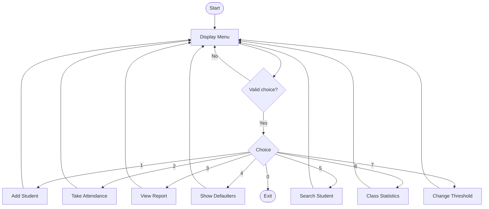

# Student Attendance Analyzer

**C Programming Lab — Mini Hackathon**

> A simple, menu-driven C program to record, analyze and report class attendance, and to flag students who fall below an attendance threshold.

---

## 1. Project Details

| | |
|---|---|
| **Project Title** | Student Attendance Analyzer |
| **Problem Statement** | Problem 7 — Develop a program to record and analyze attendance for a class of students |
| **Course** | C Programming Lab (Mini Hackathon) |
| **University** | UPES, Dehradun |
| **Faculty** | Dr. Banti Kumar |
| **Batch** | `__________` *(fill in)* |
| **Team No.** | `__________` *(fill in)* |
| **Team Name** | 3 Idiots |

### Team Members

| # | Name | SAP ID |
|---|------|--------|
| 1 | Harshal Garg | 590036016 |
| 2 | Aadi Anand | 590035166 |
| 3 | Ankit Saikia | 590032259 |

---

## 2. Problem Statement

Develop a program to record and analyze attendance for a class of students.

**Requirements (as given):**

- Store attendance for at least 10 students across multiple classes.
- Record attendance as present or absent.
- Calculate each student's attendance percentage.
- Identify students below a specified attendance threshold, such as 75%.

**Expected output:** Student-wise attendance report and list of students below the threshold.

---

## 3. Objectives

- Record daily attendance (Present / Absent) for every student.
- Calculate each student's attendance percentage automatically.
- Identify defaulters (students below the threshold) instantly.
- Tell each defaulter exactly **how many more classes they must attend** to recover.
- Give class-level insights: average, highest and lowest attendance.
- Practise core C concepts: structures, arrays, functions, loops, conditionals and input validation.

---

## 4. Features

| # | Feature | Description |
|---|---------|-------------|
| 1 | **Add Student** | Adds a student with roll number and name (up to 50). Rejects duplicate or invalid roll numbers. |
| 2 | **Take Attendance** | Records P/A for every student for the day (up to 40 classes). Accepts lowercase `p`/`a`, re-asks on invalid input. |
| 3 | **View Attendance Report** | Table of roll, name, present, absent, percentage and status (OK / SHORTAGE). |
| 4 | **Show Defaulters** | Lists only students below threshold, with the number of consecutive classes needed to reach it. |
| 5 | **Search Student** | Looks up a student by roll number and shows the full P/A history. |
| 6 | **Class Statistics** | Average, highest and lowest attendance in the class. |
| 7 | **Change Threshold** | Sets a custom threshold between 1 and 100 (default 75%). |

**Smart handling of late joiners:** a student added after some classes have already been held is **not** marked absent for those earlier classes. Attendance is counted only from the day they joined (`joinedAtClass`).

---

## 5. Algorithm

### Pseudocode

```
START
  threshold = 75
  REPEAT
    DISPLAY menu
    READ choice (validate input)
    SWITCH choice
      1: Add Student
           READ roll; IF roll <= 0 OR roll already exists -> error
           READ name; joinedAtClass = classCount; studentCount++
      2: Take Attendance
           FOR each student: READ P/A until valid; store in attendance[classCount]
           classCount++
      3: View Report
           FOR each student: present, absent, percentage = present*100 / eligibleDays
           status = (percentage >= threshold) ? OK : SHORTAGE
      4: Show Defaulters
           FOR each student with percentage < threshold:
               print details and daysNeeded
      5: Search Student
           READ roll; find index; print details and P/A history
      6: Class Statistics
           compute average, highest, lowest percentage
      7: Change Threshold
           READ value; IF 1 <= value <= 100 -> update, ELSE reject
      0: Exit
  UNTIL choice == 0
END
```

### Key Formulas

```
eligibleDays = classCount - joinedAtClass
percentage   = (daysPresent / eligibleDays) * 100

Extra classes x needed (all attended) to reach threshold T:
    (present + x) / (total + x) >= T / 100
    x = ceil( (T * total - 100 * present) / (100 - T) )
```

> If `T = 100` and the student has already missed a class, 100% can never be reached again, so the program prints *"Cannot reach 100% now."*

### Flowchart



---

## 6. C Programming Concepts Used

| Concept | Where it is used |
|---------|------------------|
| **Structures** | `struct Student` holds roll, name, attendance record and join day |
| **Arrays** | `students[50]` array of structures; `attendance[40]` character array per student |
| **Strings** | Student names stored as `char name[30]`; read with `%29[^\n]` to allow spaces |
| **Functions** | Modular design: `findStudent`, `countPresent`, `calculatePercentage`, `daysNeeded`, etc. |
| **Loops** | `do-while` for the menu and P/A validation; `for` for traversing students and classes |
| **Conditionals** | `if-else`, `switch-case` for menu, ternary operator for OK/SHORTAGE |
| **Operators** | Arithmetic, relational and logical operators for percentage and validation |
| **Input validation** | `scanf` return value checks, buffer clearing with `getchar()`, range checks |
| **Preprocessor** | `#define` for `MAX_STUDENTS` and `MAX_CLASSES` |
| **Library functions** | `ceil()` from `math.h`, `toupper()` from `ctype.h` |
| **Global variables** | `students`, `studentCount`, `classCount` shared across functions |

---

## 7. How to Compile and Run

**Requirements:** GCC (or any C compiler).

```bash
# Compile  (-lm links the math library, needed for ceil())
gcc attendance_analyzer.c -o attendance -lm

# Run
./attendance          # Linux / macOS
attendance.exe        # Windows
```

**Suggested first run:** add a few students (option 1) → take attendance for a few days (option 2) → view the report (3) → show defaulters (4).

---

## 8. Sample Test Cases

### 8.1 Sample session (3 students, 4 classes, threshold 75%)

**Attendance entered**

| Student | Day 1 | Day 2 | Day 3 | Day 4 |
|---------|:-----:|:-----:|:-----:|:-----:|
| 101 Aarav Sharma | P | P | P | P |
| 102 Riya Verma | P | A | P | A |
| 103 Kabir Singh | A | A | A | P |

**Option 3 — Attendance Report**

```
========== ATTENDANCE REPORT ==========
ROLL    NAME            PRESENT ABSENT  PERCENT STATUS
101     Aarav Sharma    4       0       100.00% OK
102     Riya Verma      2       2       50.00%  SHORTAGE
103     Kabir Singh     1       3       25.00%  SHORTAGE
```

**Option 4 — Defaulter List**

```
========== DEFAULTER LIST ==========

Roll: 102
Name: Riya Verma
Days Present: 2
Days Absent: 2
Attendance: 50.00%
Must attend next 4 days.

Roll: 103
Name: Kabir Singh
Days Present: 1
Days Absent: 3
Attendance: 25.00%
Must attend next 8 days.
```

**Option 6 — Class Statistics**

```
========== CLASS STATISTICS ==========
Total Students: 3
Total Days: 4
Average Attendance: 58.33%
Highest Attendance: 100.00% (Aarav Sharma)
Lowest Attendance: 25.00% (Kabir Singh)
```

### 8.2 Test case table

| # | Test | Input | Expected | Actual | Result |
|---|------|-------|----------|--------|:------:|
| 1 | Normal — add student | Roll `101`, name `Aarav` | Student added | `Student added successfully!` | Pass |
| 2 | Duplicate roll number | Roll `101` again | Rejected | `Invalid or duplicate roll number!` | Pass |
| 3 | Non-numeric roll number | `abc` | Rejected, no crash | `Invalid input!` | Pass |
| 4 | Invalid menu input | `x` | Rejected, menu re-shown | `Invalid input!` | Pass |
| 5 | Out-of-range menu choice | `9` | Rejected | `Invalid choice!` | Pass |
| 6 | Invalid attendance entry | `Z` | Re-asks | `Enter P or A only!` | Pass |
| 7 | Lowercase attendance | `p` | Accepted as `P` | Accepted | Pass |
| 8 | Boundary — exactly at threshold | 3 present of 4 (75%) | `OK` | `OK` | Pass |
| 9 | Student below threshold | 2 present of 4 (50%) | `SHORTAGE`, needs 4 more days | `SHORTAGE`, `Must attend next 4 days.` | Pass |
| 10 | Late joiner | Added after Day 2, present on Day 3 | 1 of 1 = 100%, earlier days ignored | `1  0  100.00%  OK` | Pass |
| 11 | Search unknown roll | `999` | Not found | `Student not found!` | Pass |
| 12 | Threshold = 100 after a miss | 2 of 3 present | Cannot recover | `Cannot reach 100% now.` | Pass |
| 13 | Invalid threshold | `150` | Rejected, reset to 75 | `Invalid threshold!` | Pass |
| 14 | Report with no students | Option 3 on empty list | Message shown | `No students available!` | Pass |

---

## 9. Limitations and Future Scope

- Data is held in memory only and is lost when the program exits. **Future:** save and load attendance using file handling (`fopen`, `fprintf`, `fscanf`).
- Attendance cannot be edited after submission. **Future:** an option to correct a day's entry.
- Fixed limits of 50 students and 40 classes. **Future:** dynamic memory with `malloc`.
- **Future:** sort the report by percentage, subject-wise attendance, and exporting to CSV.

---

## 10. Repository Structure

```
Batch__Team__AttendanceAnalyzer/
├── README.md
├── attendance_analyzer.c
├── presentation.pptx
└── screenshots/
    └── sample_output.png
```

---

## 11. Acknowledgement

We thank **Dr. Banti Kumar** for guidance and support throughout the C Programming Lab Mini Hackathon.

*Team 3 Idiots: Harshal Garg · Aadi Anand · Ankit Saikia*
